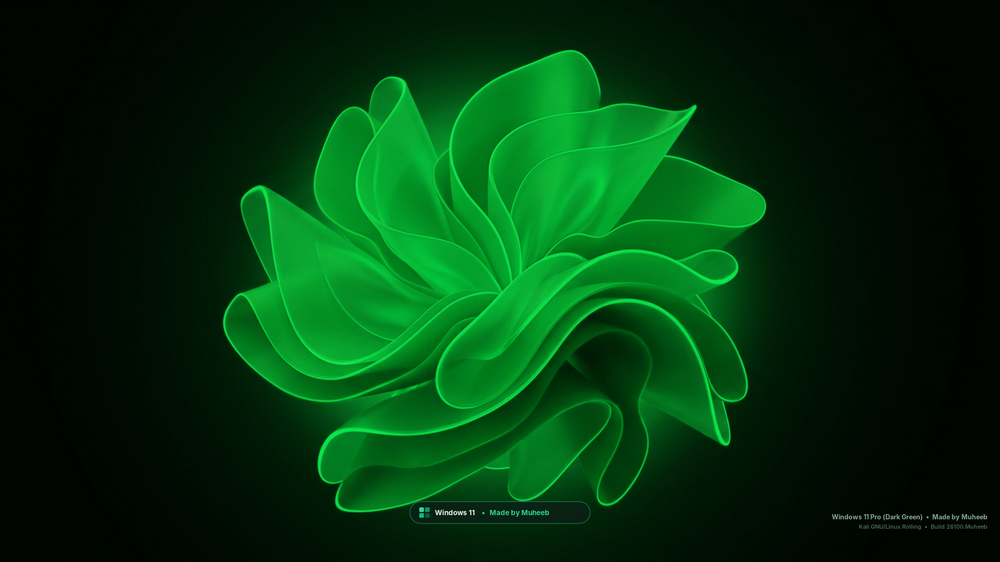
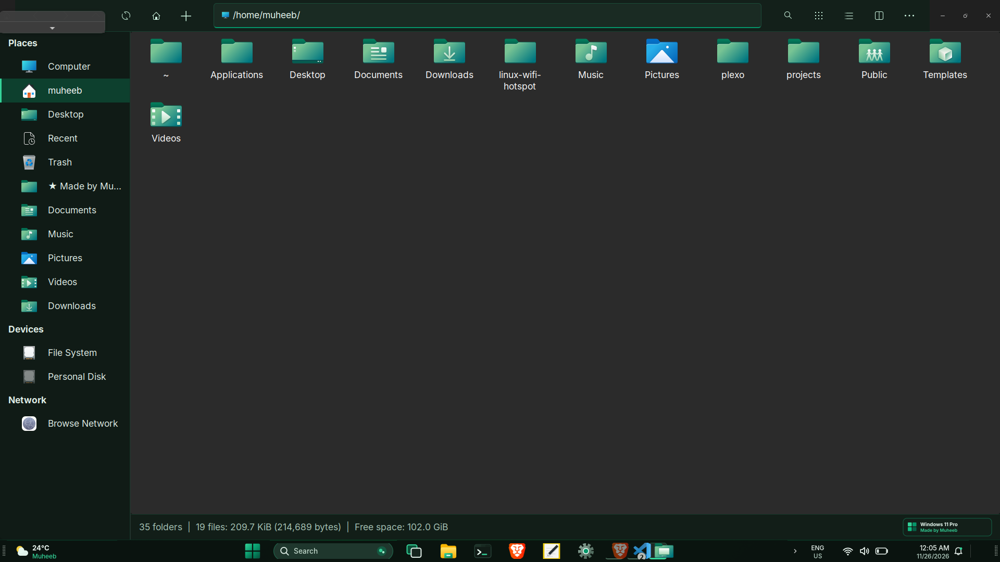
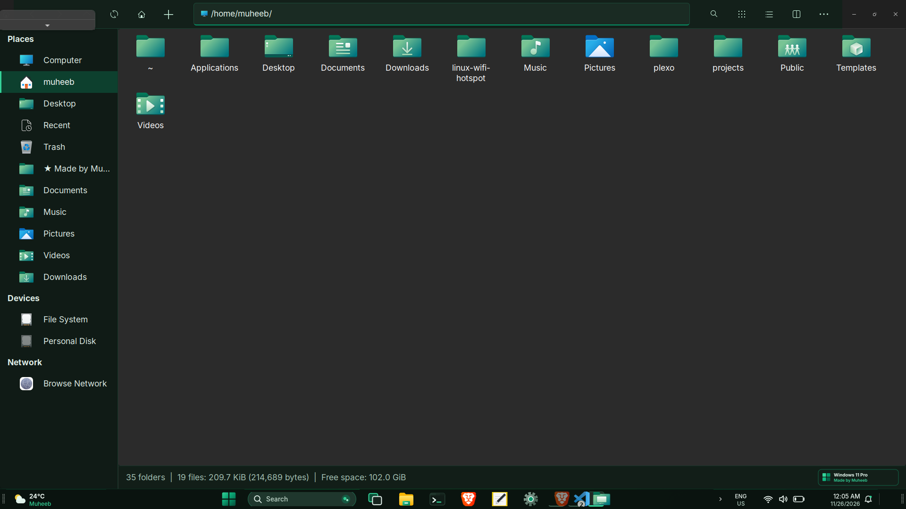

<div align="center">

# ⊞ Windows 11 Pro (Dark Green Edition) Theme for Kali Linux

### Complete Windows 11 XFCE Desktop Transformation • 125% Display Scale • Centered Taskbar • In-Panel Wi-Fi & Bluetooth • Customizable Search • Explorer & Shortcuts

**Crafted & Engineered by [Muheeb Bin Nadeem](https://muheebbinnadeem.cv) (`Made by Muheeb`)**

[](https://www.kali.org/)
[](https://xfce.org/)
[-34D399?style=for-the-badge)](#%EF%B8%8F-display-scaling--customization-win--i)
[](https://muheebbinnadeem.cv)
[](https://wa.me/923074171882)
[](LICENSE)

<br/>



</div>

---

## 🌟 Overview — Exact Windows 11 Experience on Kali Linux

Looking for an **exact Windows 11 theme for Kali Linux** (like *Kali Undercover Mode*, upgraded to **Windows 11 24H2 Dark Green Mica**)?  
This self-contained repository transforms **Kali GNU/Linux (XFCE)** into a pixel-accurate **Windows 11 Pro Dark Green Desktop** in **one command**, complete with automatic backup and one-command restore.

### Live Desktop Previews

| Start Menu & File Explorer (125% Scale) | Quick Settings (In-Panel Wi-Fi & Bluetooth) |
|---|---|
|  |  |

---

## ✨ Full Feature List

- **🎯 True-Centered `56px` Windows 11 Taskbar (`125%` Recommended Scale / `120 DPI`)**
  - Mathematical left-right width balancing places Start, Search, Task View, Explorer, Terminal, Browser, VS Code, Settings, and Running App icons **dead-center** on screen.
  - Crisp **monochrome Fluent vector tray icons** (`Wi-Fi + Speaker + Battery` unified Quick Settings pill & `Time/Date + Bell` Notification pill) — zero duplicate Linux `nm-applet` or `blueman` clutter.
- **📶 Complete In-Panel Wi-Fi, Bluetooth & Sound Management (`Win + A`)**
  - Scan nearby **Wi-Fi networks**, enter passwords, connect, and disconnect directly inside the bottom-right Quick Settings flyout.
  - Discover, connect, and disconnect **Bluetooth devices** and switch **Audio Output** devices without leaving the taskbar.
  - Live **Brightness** & **Volume** sliders plus **Night Light**, **Battery Saver**, **Airplane Mode**, and **Do Not Disturb** toggles.
- **🔍 Customizable Windows 11 Search Bar (`Win + S`)**
  - Live switch between **Full Search Box**, **Compact Pill**, **Icon Only**, or **Hidden** directly on the taskbar.
  - Customize taskbar search label text, default web search engine (`Google`, `DuckDuckGo`, `Brave`, `Bing`), instant math calculator, and home file search.
- **🔔 Two-Card Notification Center & Interactive Calendar (`Win + N`)**
  - Separate floating **Notifications** card (synced with live desktop notifications) + interactive **Month Calendar & Focus Session Timer**.
- **📁 Exact Windows 11 File Explorer (`Thunar`)**
  - Dark Green Windows 11 folders, Fluent navigation bar (`←`, `→`, `↑`, `⟳`, rounded Address Bar with emerald focus underline, Split View), `★ Made by Muheeb` Quick Access, and right-click `Open in Windows Terminal`.
- **✂️ Windows 11 Snipping Tool (`Win + Shift + S` / `Print` / `Win + Print`)**
  - Region, Window, and Fullscreen screenshots automatically saved to `~/Pictures/Screenshots/` **and** copied straight to your clipboard.
- **🔒 Permanent Boot Persistence & Safe Backup**
  - Automatically loads your Windows 11 Dark Green desktop on every reboot (`~/.config/autostart/win11-muheeb-session.desktop`), while keeping your original Kali XFCE config safely backed up for 1-command restore.

---

## 🚀 Step-by-Step Installation Process (Kali Linux XFCE)

Open your Kali Linux terminal and run:

```bash
# 1. Clone this repository
git clone https://github.com/muheeb/kali-windows-11-dark-green-theme.git "Window Theme Repo"
cd "Window Theme Repo"

# 2. Make installer & uninstaller executable
chmod +x install.sh uninstall.sh

# 3. Run the one-command installer (automatically backs up your existing Kali setup!)
./install.sh
```

> **Note:** All GTK3/GTK4 themes, Windows 11 Dark Green icons, Windows 11 cursors, 1080p wallpapers, and Fluent shell apps are **pre-bundled inside this repository** — installation finishes in seconds!

### 🔄 How to Uninstall / Restore Original Kali Linux Desktop

Want to switch back to your original Kali Linux XFCE layout at any time? Run:

```bash
./uninstall.sh
```

---

## ⚙️ Display Scaling & Customization (`Win + I`)

Press **`Win + I`** (or click the **Settings** icon on the taskbar) anytime to customize:
- **Display Scale**: Switch live between `100%`, **`125% (Recommended)`**, or `150%`
- **Desktop Wallpaper**: Switch between **Dark Green Bloom** and **Light Emerald Bloom** (`Made by Muheeb`)
- **Taskbar Search Style**: Choose `Search Box`, `Compact Pill`, `Icon Only`, or `Hidden`

---

## ⌨️ Complete Windows 11 Keyboard Shortcuts

| Shortcut | Action |
|---|---|
| `Win` (tap) or `Ctrl + Esc` | Open / Close **Windows 11 Start Menu** |
| `Win + S` / `Win + Q` | Open **Customizable Search** |
| `Win + A` | Open **Quick Settings (Wi-Fi, Bluetooth, Brightness, Sound)** |
| `Win + N` | Open **Notification Center & Calendar** |
| `Win + W` | Open **Widgets Board** |
| `Win + E` | Open **File Explorer** |
| `Win + I` | Open **Windows 11 Settings & Display Scale** |
| `Win + R` | Open **Run Dialog** (`cmd`, `wt`, `explorer`, `notepad`, `winver`) |
| `Win + X` | Open **Power User Quick Link Menu** |
| `Win + Shift + S` or `Print` | Open **Snipping Tool** (Region / Window / Fullscreen) |
| `Win + Print` | **Instant Fullscreen Screenshot** (`~/Pictures/Screenshots` + Clipboard) |
| `Win + L` | **Lock Screen** |
| `Win + D` | **Show / Toggle Desktop** |
| `Win + V` | **Clipboard History** |
| `Win + Tab` / `Alt + Tab` | **Task View** / **Switch Windows** |
| `Win + Left / Right / Up / Down` | **Aero Snap** Left / Right / Maximize / Minimize |
| `Ctrl + Win + D / F4 / Left / Right` | **Virtual Desktops** (Create / Close / Switch) |
| `Ctrl + Shift + Esc` | **Task Manager** |
| `Alt + F4` | **Close Active Window** |

---

## 💖 Support & Sponsor This Project

If you like this **Windows 11 Dark Green Kali Linux Theme** and want to support ongoing open-source development or hire **Muheeb** for custom projects, feel free to contribute or reach out!

| Channel | Details |
|---|---|
| 🏦 **Bank Transfer** | **Askari Bank Limited** — Account No: **`02110200000209`** |
| 🌐 **Portfolio / Website** | **[Muheebbinnadeem.cv](https://muheebbinnadeem.cv)** |
| 💬 **WhatsApp** | **[0307 4171882](https://wa.me/923074171882)** (`+92 307 4171882`) |

---

## 🏷️ SEO Keywords & Topics

`windows-11-theme-kali-linux` • `kali-linux-windows-11` • `xfce-windows-11-theme` • `kali-undercover-windows-11` • `dark-green-gtk-theme` • `linux-desktop-customization` • `windows-11-taskbar-linux` • `thunar-windows-11-explorer` • `made-by-muheeb`

---

<div align="center">
  <b>Designed &amp; Built with ❤️ by <a href="https://muheebbinnadeem.cv">Muheeb Bin Nadeem</a> (<code>Made by Muheeb</code>)</b>
</div>
